# Giftify

Giftify es una aplicación Flutter para descubrir y elegir regalos según la
persona, la ocasión, el presupuesto y los intereses. El flujo incluye catálogo,
carrito, direcciones, métodos de pago ficticios y checkout local simulado.

## Descripción

La aplicación está pensada como un MVP académico mobile-first. No depende de un
backend, no procesa pagos reales y no crea órdenes de compra persistentes.

## Funcionalidades principales

- Registro e inicio de sesión local.
- Restauración de sesión.
- Home con accesos rápidos y categorías de descubrimiento.
- Búsqueda personalizada y resultados priorizados.
- Catálogo de 36 productos.
- Detalle de producto.
- Carrito persistente por usuario.
- Gestión de direcciones: crear, editar, principal, archivar y restaurar.
- Métodos de pago ficticios por usuario.
- Checkout V2 con dirección y pago guardados.
- Confirmación de pedido simulada.
- Perfil y preferencias de apariencia.
- Tema Claro, Oscuro y Sistema.
- Aislamiento de datos entre usuarios.

## Stack

- Flutter
- Dart
- Riverpod
- SQLite / `sqflite`
- `sqflite_common_ffi_web` para SQLite en Web
- SharedPreferences
- `cryptography` para PBKDF2

## Persistencia

SQLite almacena:

- `users`
- `delivery_addresses`
- `payment_methods`

SharedPreferences almacena:

- sesión (`user_id`);
- `ThemeMode`;
- carrito por usuario;
- productos eliminados por usuario;
- markers de migración de ownership.

En Web, SQLite funciona mediante `sqflite_common_ffi_web`, con
`web/sqlite3.wasm` y `web/sqflite_sw.js`. La persistencia del navegador usa
IndexedDB. El soporte Web de `sqflite_common_ffi_web` debe considerarse una
solución de desarrollo.

## Seguridad local

- Las contraseñas no se almacenan en texto plano.
- Se usa PBKDF2-HMAC-SHA256 con salt individual.
- Los métodos de pago son ficticios.
- No se almacena PAN completo.
- No se almacena CVV.
- No hay gateway ni procesamiento de pagos real.
- Checkout es una simulación académica; no se declara PCI DSS.

## Capturas de la aplicación

### Autenticación

| Inicio de sesión | Creación de cuenta |
| --- | --- |
| 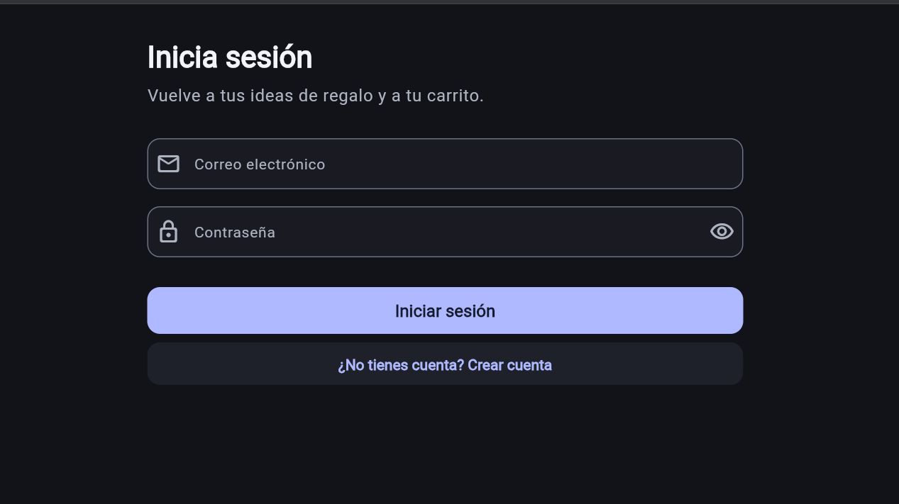 | 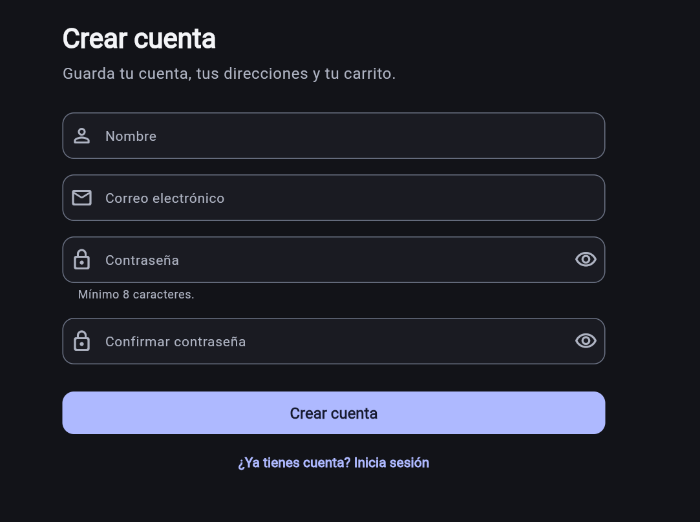 |

### Inicio y descubrimiento

| Pantalla principal | Búsqueda personalizada |
| --- | --- |
| 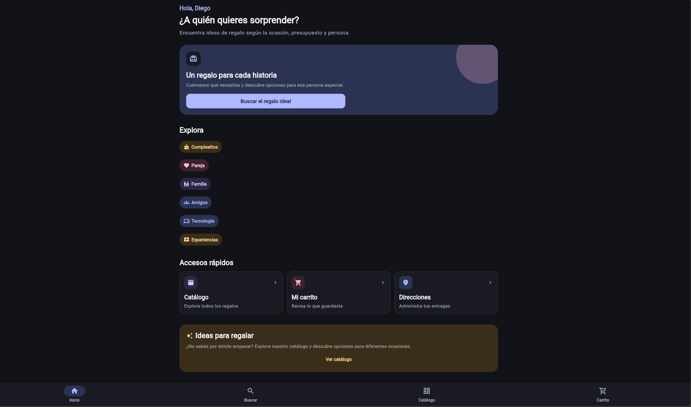 | 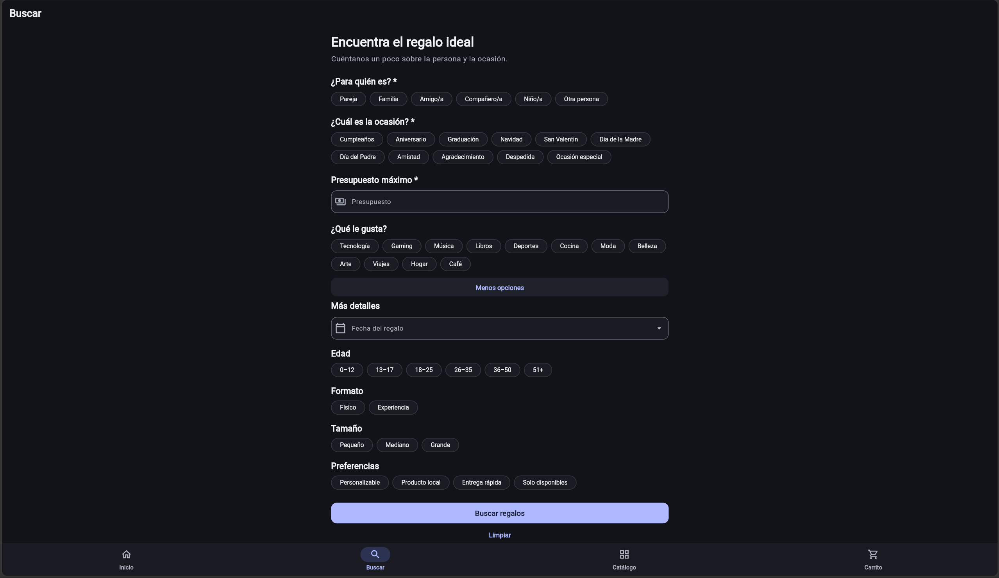 |

### Catálogo y carrito

| Catálogo | Carrito |
| --- | --- |
| 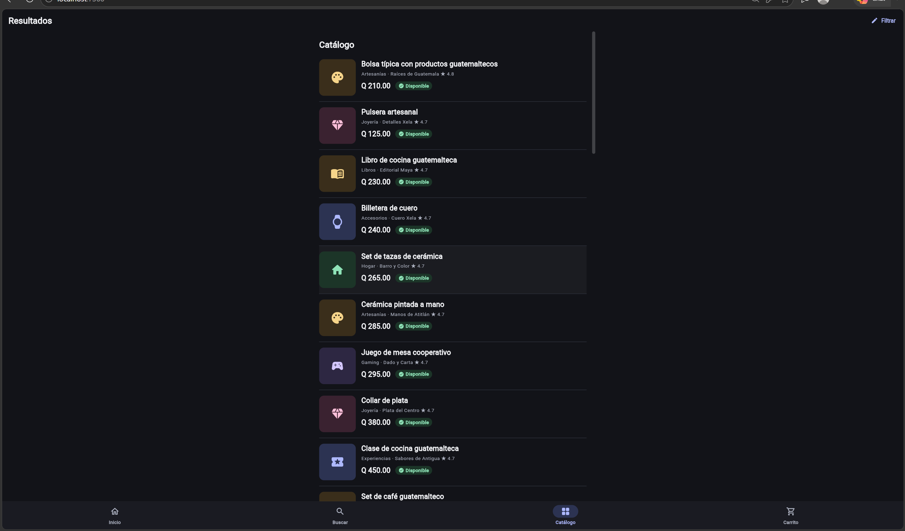 | 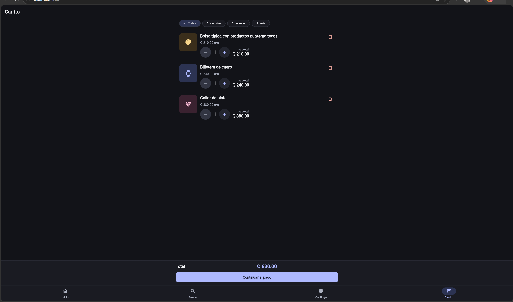 |

### Direcciones

| Direcciones | Registro de dirección |
| --- | --- |
| 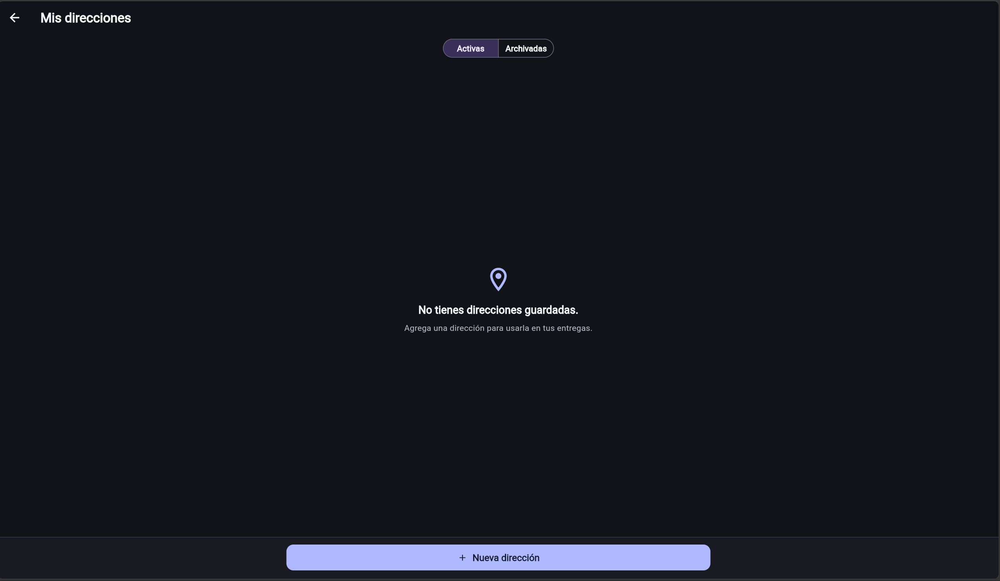 | 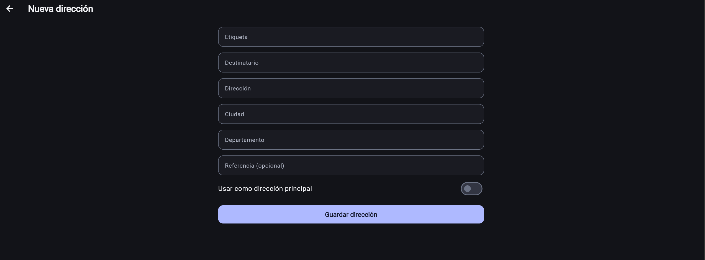 |

| Dirección registrada | Dirección archivada |
| --- | --- |
|  | 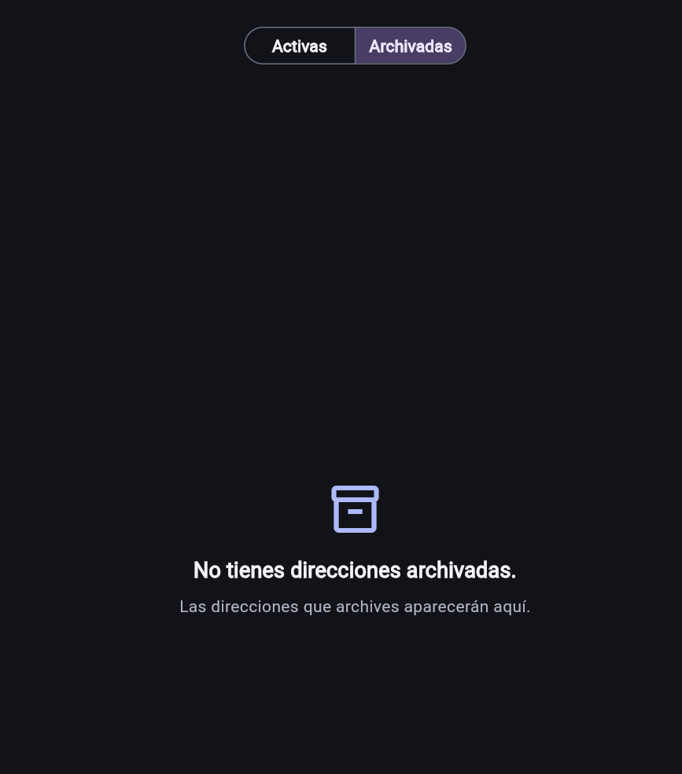 |

### Perfil y apariencia

| Perfil | Configuración de apariencia |
| --- | --- |
| 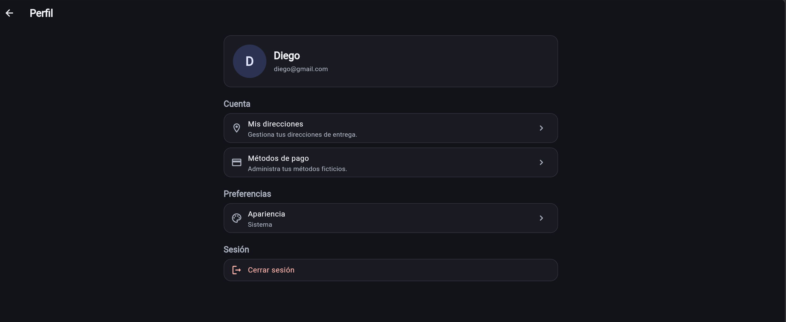 | 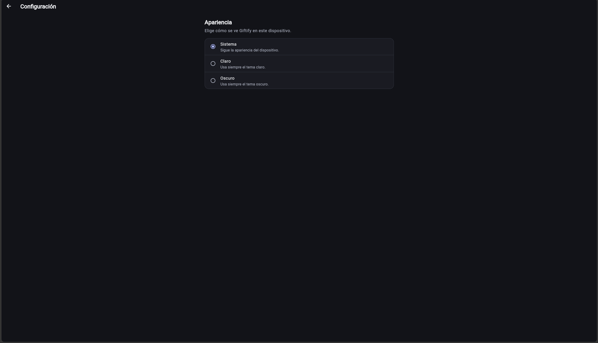 |

### Métodos de pago

| Métodos de pago | Agregar método de pago |
| --- | --- |
| 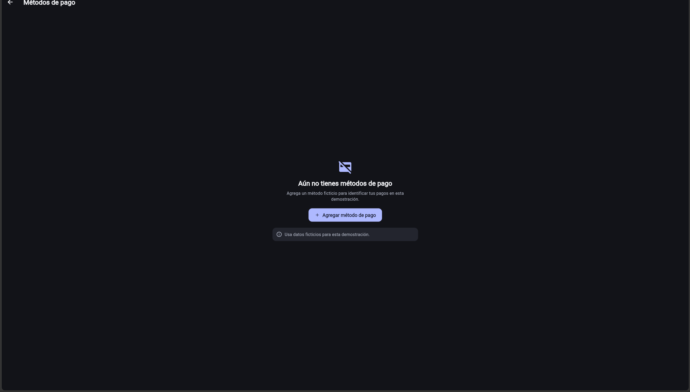 | 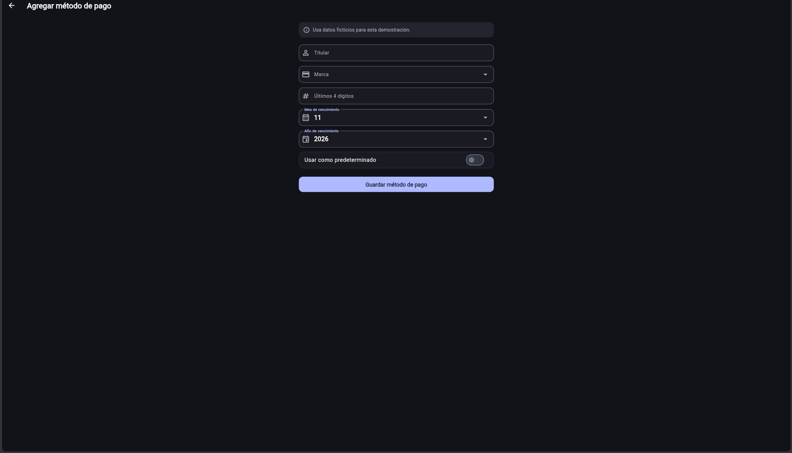 |

### Checkout

| Confirmación de compra | Pedido confirmado |
| --- | --- |
| 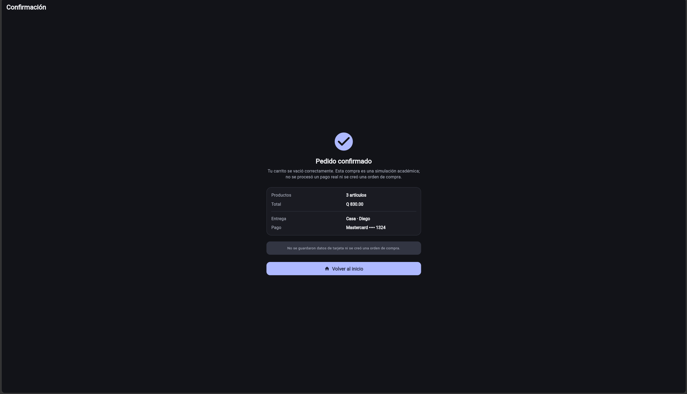 | 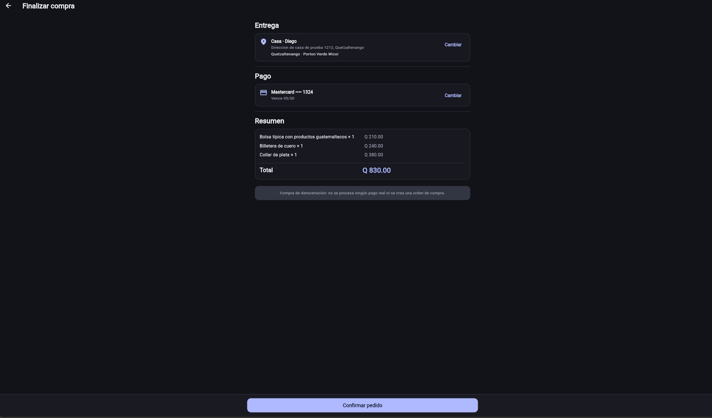 |

## Ejecución

```bash
cd giftify
flutter pub get
flutter run
```

Para Web con persistencia SQLite, usar un puerto fijo:

```bash
cd giftify
flutter run -d edge --web-port 7366
```

El puerto fijo mantiene el mismo origen de IndexedDB entre reinicios.

## Calidad

```bash
cd giftify
dart format --output=none --set-exit-if-changed lib test
flutter analyze
flutter test
flutter build web
```

Estado verificado:

- **423 pruebas aprobadas**.
- `flutter analyze`: sin issues.
- `flutter build web`: correcto.

La validación manual en Android sigue pendiente de un dispositivo o emulador
con SQLite real.

## Estructura

```text
giftify/
├── lib/
│   ├── app/            # Router, shell, tabs y autenticación de rutas
│   ├── core/           # Tema y SQLite
│   ├── features/       # Auth, Home, Search, Products, Cart, Addresses,
│   │                   # Payments, Checkout, Profile y Settings
│   └── shared/         # Modelos, enums y catálogo mock
├── test/               # Widgets, providers, repositorios y SQLite
├── web/                # Entrada Web y binarios de SQLite
└── pubspec.yaml
```

## Limitaciones

- No hay Orders ni historial de compras.
- No hay backend, gateway ni pagos reales.
- No hay recuperación de contraseña ni edición de perfil.
- Android no se ha validado manualmente en este entorno.
- Windows desktop no forma parte del flujo Web validado.
- Web requiere los binarios SQLite generados y un origen estable.

## Documentación

- `docs/fases/`: decisiones técnicas por fase.
- `docs/qa/`: checklist de QA manual.
- `docs/equipo/`: contexto y responsabilidades.
- `docs/bitacoras/`: registro por integrante.
